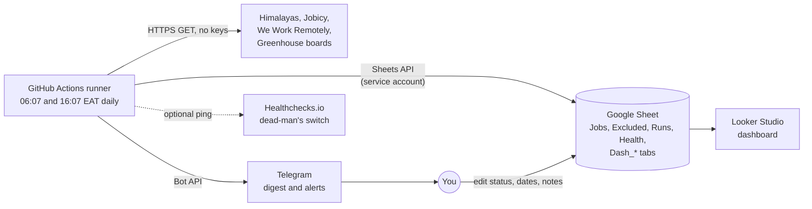

# Job Scraper: Complete Guide

Installation, running, connections, tools, every site it reads, what each build phase delivered, and a self-check quiz.

**Contents**
1. [What this is, and an honest status](#1-what-this-is-and-an-honest-status)
2. [How the pieces connect](#2-how-the-pieces-connect)
3. [Keys and secrets](#3-keys-and-secrets)
4. [Step-by-step installation](#4-step-by-step-installation)
5. [The websites it reads](#5-the-websites-it-reads)
6. [Tools and libraries used](#6-tools-and-libraries-used)
7. [How one run works, and what is stored where](#7-how-one-run-works-and-what-is-stored-where)
8. [Running it day to day](#8-running-it-day-to-day)
9. [Command reference and exit codes](#9-command-reference-and-exit-codes)
10. [Troubleshooting](#10-troubleshooting)
11. [What each phase handled](#11-what-each-phase-handled)
12. [Quiz and FAQ](#12-quiz-and-faq)

---

## 1. What this is, and an honest status

A personal tool that finds recent customer-care and related jobs (Kenya, East Africa, Africa, and remote roles open to Kenya-based applicants),
scores each against your profile with a visible breakdown, saves them to a private Google Sheet, sends a Telegram digest twice a day, tracks
your applications and follow-ups, watches its own sources for breakage, and feeds a Looker Studio dashboard. It never applies for you, never logs
in to any site, and never gets around a block.

It runs **entirely on GitHub Actions** (free tier, private repository) and stores everything in **your Google Sheet**. No server, nothing on your laptop.

**Status you should know before relying on it**

| Item | State |
|---|---|
| Code for Phases 2 to 8 | Written and packaged |
| Run against real services (real Sheet, Telegram, job sites) | **Not yet.** I built it in a sandbox with no internet. You do the first live runs |
| Automated tests | 267 pass in my offline environment (using stand-ins for some libraries), 1 fails on purpose, 71 could not run offline. Run `pytest` on your machine |
| Job sites with a working reader | **4**: Himalayas, Jobicy, We Work Remotely, Greenhouse company boards |
| Job sites verified in the design docs but with **no reader built yet** | RemoteOK, Working Nomads, Arbeitnow, Lever, Ashby, SmartRecruiters, Workable, Adzuna, Jooble, Careerjet, ReliefWeb |
| Kenyan boards (BrighterMonday, MyJobMag, Fuzu, PSC, Ajira) | Still `pending` review. No reader. Use their own email alerts |
| LinkedIn, Indeed, Glassdoor | Never scraped (their terms forbid it). Email-alert ingestion was planned but **not built** |
| Sample test data | Currently guessed. Replace it with real responses using `sources check --save-fixtures` (section 4.7) |

---

## 2. How the pieces connect



| Connection | Direction | Needs from you | What breaks if it is missing |
|---|---|---|---|
| GitHub Actions | runs the program | Private repo, 4 secrets, workflow on the default branch | Nothing runs on schedule |
| Job sites | program reads | Nothing (no API keys for the 4 readers) | That source is marked failed; the others still run |
| Google Sheets | program reads and writes | Google Cloud project, Sheets API on, service account + JSON key, Sheet shared with it as Editor | Run fails (exit 3), alert sent, new jobs kept as a downloadable file |
| Telegram | program sends | Bot token, your chat ID, and you must message the bot once first | Jobs still saved; no digest; run exits 4 |
| Healthchecks.io | workflow pings | Optional ping URL | You are not told when the whole schedule silently stops |
| Looker Studio | reads the Sheet | A report you build once (guide in `docs/looker-studio.md`) | Dashboard only; the pipeline is unaffected |

---

## 3. Keys and secrets

You need **no API key for any job site** (all four readers use public endpoints). The only secrets are for Telegram and Google.

| Name | What it is | Where it comes from | Required? |
|---|---|---|---|
| `TELEGRAM_BOT_TOKEN` | Lets the program post as your bot | Telegram, chat with `@BotFather`, send `/newbot` | Yes (to get messages) |
| `TELEGRAM_CHAT_ID` | The chat the bot may message | See 4.3 | Yes (to get messages) |
| `GOOGLE_SERVICE_ACCOUNT_JSON_B64` | The service-account key file, base64-encoded in one line | Google Cloud, see 4.4 | Yes |
| `GOOGLE_SHEET_ID` | Which spreadsheet to use | The long id in the Sheet's URL between `/d/` and `/edit` | Yes |
| `HEALTHCHECK_URL` | Ping address of your Healthchecks.io check | healthchecks.io (free), create a check | Optional (workflow only) |
| `ADZUNA_APP_ID`, `ADZUNA_APP_KEY`, `JOOBLE_API_KEY`, `CAREERJET_AFFID`, `RELIEFWEB_APPNAME` | Keys for sources planned for later | Each provider | **Not needed now.** No reader uses them yet |

Where secrets live: **GitHub** repository secrets (for the daily run) and a **local shell environment** (for manual runs). They never go in the
code, the config files, the logs or the repository. `.env` is git-ignored.

> The program does **not** read a `.env` file by itself. Load it into your shell first:
> - macOS or Linux: `set -a; source .env; set +a`
> - Windows PowerShell: `Get-Content .env | ForEach-Object { if ($_ -match '^\s*([^#=]+)=(.*)$') { [Environment]::SetEnvironmentVariable($matches[1].Trim(), $matches[2].Trim()) } }`

If a secret is ever pasted into a chat, a commit or a log, treat it as leaked: create a new one, update the GitHub secret, run the workflow once, then revoke the old one.

---

## 4. Step-by-step installation

### 4.0 What you need first
- A **GitHub** account, a **Google** account, a **Telegram** account.
- **Python 3.12** and **git** on your computer. For `scripts/lock.sh` you need **bash** (macOS, Linux, or WSL on Windows).
- About an hour for the first setup, plus 30 to 45 minutes to build the dashboard.

### 4.1 Get the code
Unzip `job-scraper-phase8.zip`. You get a folder `job-scraper/`. Open a terminal in it.

### 4.2 Local environment
```bash
python3.12 -m venv .venv
source .venv/bin/activate            # Windows: .venv\Scripts\activate
pip install -r requirements-dev.in
cp config/sources.example.yaml  config/sources.yaml
cp config/profile.example.yaml  config/profile.yaml
cp config/scoring.example.yaml  config/scoring.yaml
cp .env.example .env                 # fill in values later; never commit this file
```
(`config/settings.example.yaml` is optional. Copy it to `config/settings.yaml` only if you want to change alert, retention or digest thresholds.)

### 4.3 Telegram bot
1. In Telegram open **@BotFather**, send `/newbot`, follow the prompts, copy the **token**.
2. Open a chat with your new bot and send it any message. (A bot cannot message you until you have.)
3. In a browser, open `https://api.telegram.org/bot<YOUR_TOKEN>/getUpdates` and find `"chat":{"id":123456789`. That number is your **chat ID**.
   Do this privately: the address contains your token.
4. Put both in `.env` and, later, in GitHub secrets.

### 4.4 Google Sheet and service account
1. **Google Cloud Console**: create a project. Under *APIs & Services*, enable the **Google Sheets API**.
   (The program opens the Sheet by its ID, so the Drive API is normally not needed. If an error says the Drive API is not enabled, enable it too.)
2. *Credentials*, **Create credentials**, **Service account**. Give it **no project roles**. Open it, *Keys*, **Add key**, **JSON**. A file downloads.
   If your Google account is managed by an organisation that blocks key creation, you will need to use another account or ask the admin.
3. Create a new **Google Sheet**. Rename the first tab to exactly **`Jobs`**. That is the only tab you must create. The program creates `Runs`, `Excluded`, `Health` and the six `Dash_*` tabs itself, and writes the `Jobs` header row on first use.
4. Click **Share**, paste the service account's `client_email` (inside the JSON file), give it **Editor**. Do not use link sharing. Turn on 2-step verification on your Google account.
5. Copy the **Sheet ID** from the URL.
6. Encode the key as one line, then **delete the JSON file**:
   - Linux: `base64 -w0 key.json`
   - macOS: `base64 -i key.json | tr -d '\n'`
   - Windows PowerShell: `[Convert]::ToBase64String([IO.File]::ReadAllBytes("key.json"))`
7. In the Sheet, give the **`application_status`** column a dropdown (Data, Data validation) with: `New, Saved, Applied, Interview, Offer, Rejected, Ignored`. The program does not create it for you.

You own only these columns: `application_status`, `applied_on`, `follow_up_date`, `notes`, `priority`. The program never overwrites them.

### 4.5 Configure
| File | What to edit |
|---|---|
| `config/sources.yaml` | For each source: `enabled`, `status: verified`, `verified_on`, and a real `terms_url` of the page you reviewed. For Greenhouse, list company `boards` (a board token and display name each). Only add a token after it returns a valid public response |
| `config/profile.yaml` | Your target job titles (strong, potential, stretch), skills (full and partial), preferred or avoided industries, optional salary floor, and transferable strengths. **No personal identifiers. Your CV never goes in the repo** |
| `config/scoring.yaml` | Point values (defaults follow the design), tier cut-offs, filters, skill dictionary, industry keywords. Raise `scoring_version` whenever you change a value |
| `config/settings.yaml` | Optional thresholds: source-health alerts, retention periods, digest sizes |

The source gate is enforced in code: a source runs only if `enabled: true` **and** `status: verified`.

### 4.6 Check the sites are reachable (live, from your computer)
```bash
set -a; source .env; set +a
python main.py sources check
```
For each enabled source it fetches one page and reports reachability, how many records parsed, and sample titles. Nothing is saved.
It refuses to contact sources marked blocked, alerts-only or retired.

### 4.7 Replace the guessed test data with real data
```bash
python main.py sources check --save-fixtures tests/fixtures/captured
```
This saves one real response per source with emails and phone numbers removed and only the first 5 records. **Read each file** before committing it.
`tests/test_captured_fixtures.py` then checks each reader against the real response, so a changed site format fails a test instead of silently losing jobs.
If a reader fails against real data, send me the failure and I will fix the reader.

### 4.8 First runs on your computer
```bash
pytest                                              # all tests (expect 1 failure until step 4.9 pins the Actions)
python main.py run --dry-run                        # fetch, filter, score, print. Saves and sends nothing
python main.py run --storage sqlite --no-notify     # saves to a local file output/jobs.db; run it twice, the second adds 0
python main.py notify-test                          # one test message to your Telegram chat
python main.py run --no-notify                      # writes to your REAL Sheet, prints the digest instead of sending
python main.py run                                  # the real thing: Sheet, Telegram, dashboard
```
Open the Sheet and check: jobs appear, scores and tiers are filled, `application_status` says New, and the `Dash_Jobs` tab has formatted dates.

### 4.9 Calibrate the scoring (about 30 jobs)
```bash
python main.py calibrate --export output/labels.csv     # a list of real jobs, without their scores
# open it, read each posting, fill the label column with apply, maybe, or skip
python main.py calibrate --labels output/labels.csv     # agreement report; target 80% for Top/Strong vs apply
```
Change weights only in `scoring.yaml` and raise `scoring_version`.

### 4.10 Put it on GitHub (this is what makes it automatic)
1. Create a **private** repository. In your project folder: `git init`, add all files, make the first commit. Run
   `gitleaks detect --source . --log-opts="--all"`. It must find nothing.
2. **Lock the dependencies** (needs internet, Python 3.12, bash): `scripts/lock.sh`. Commit the two files it creates, `requirements.txt` and `requirements-dev.txt`.
3. **Pin the Actions**: `python scripts/pin_actions.py`. It replaces the `UNPINNED` placeholders in `.github/workflows/` with exact commit SHAs. Commit the result.
   (Pinning stops a compromised third-party Action from changing under you.)
4. Run `ruff format . && ruff check --fix .`, then `mypy src` and `pytest`, and fix what they report. CI runs the same checks on every push, and I have not been able to run ruff or mypy myself, so expect some findings the first time.
5. Push to the **default branch** (`main`).
6. Repository **Settings, Secrets and variables, Actions**, add the four required secrets (and `HEALTHCHECK_URL` if you use it).
7. **Settings, Actions, General**: allow Actions, and set *Workflow permissions* to read-only.
8. **Actions tab, daily-run, Run workflow**, try in order: mode `dry-run`, then `no-notify`, then `normal`. Then run once with sources set to `bogus` to prove the failure alert reaches you.
9. Wait for scheduled runs. In the Actions list they show the **schedule** event. Confirm three in a row.
10. Optional but recommended: create a free **Healthchecks.io** check (period 1 day, grace 3 hours), save its URL as `HEALTHCHECK_URL`. It alerts you if no successful run pings in about 27 hours.

### 4.11 Build the dashboard
Run the workflow once in mode **`dashboard`** (or `python main.py dashboard`) so the `Dash_*` tabs exist, then follow `docs/looker-studio.md`
(six data sources, field types, calculated fields, six pages). Keep the report private: it shows your application history.

---

## 5. The websites it reads

Everything below is read through public APIs or feeds. There is **no HTML scraping, no browser automation, no login, no proxy and no CAPTCHA handling.**

### 5.1 Working readers

| Site (id) | How | Address | Key? | What it brings | Notes |
|---|---|---|---|---|---|
| Himalayas (`himalayas`) | Public JSON API | `himalayas.app/jobs/api` | No | Remote jobs, with country restrictions, salary range, seniority | Reads up to 3 pages of 20 per run by default. Paging style was written from memory: confirm with `sources check` |
| Jobicy (`jobicy`) | Public JSON API | `jobicy.com/api/v2/remote-jobs` | No | Remote jobs with a region, level and salary | Published limit: at most one request per hour. Two runs a day is fine. Optional `query_params` in `sources.yaml` |
| We Work Remotely (`weworkremotely`) | RSS feed | `weworkremotely.com/categories/remote-customer-support-jobs.rss` | No | Customer-support category, region text, company in the title | Extra feeds can be listed under `feeds` |
| Greenhouse boards (`greenhouse`) | Employers' public job-board API | `boards-api.greenhouse.io/v1/boards/{token}/jobs?content=true` | No | Every opening at each company you list | One reader serves any number of companies. Each is a `token` in `sources.yaml`. A bad token marks that one board failed and the source `partial`, not the whole source |

All response shapes in these readers were written from memory of the public docs. Treat step 4.7 as mandatory.

### 5.2 How politely it behaves
Identifying User-Agent `JobScraper/0.1 (personal job-search tool)`; HTTPS only; only the hosts listed above; refuses addresses that resolve to private or internal networks;
at most 3 redirects, each re-checked; responses over 5 MB rejected; 5 s connect and 20 s read timeouts; 3 attempts with 2 s and 4 s back-off;
HTTP 429 is not retried and the source is marked rate-limited; HTTP 401 or 403 is never retried and never worked around; one request per second per host at most;
`robots.txt` is checked for any HTML source (none exist yet) and an unreadable one counts as "no".

### 5.3 Sites reviewed but not read
| Group | Sites | State |
|---|---|---|
| Verified in the design log, **no reader written** | RemoteOK, Working Nomads, Arbeitnow, Lever, Ashby, SmartRecruiters, Workable, Adzuna, Jooble, Careerjet, ReliefWeb | Each needs one adapter file plus a `sources.yaml` entry. Adzuna's Kenya coverage was never recorded |
| Kenyan boards | BrighterMonday, MyJobMag, Fuzu, PSC, Ajira | `pending`. Their `robots.txt` and terms must be read first. If they fail the gate, use their email alerts |
| Retired | Remotive | Request limit, a reported `robots.txt` conflict, and overlap with the others |
| Never scraped | LinkedIn, Indeed, Glassdoor, Google results | Terms forbid it. Use their own email alerts |

Adding a source later: complete the source gate and verification record, add the entry to `sources.yaml` (`status: verified`), write one adapter and a fixture test,
run `sources check`, then `run --dry-run --sources <id>`, then enable it.

---

## 6. Tools and libraries used

**Services**

| Tool | Role | Cost |
|---|---|---|
| GitHub Actions | Runs the program on a schedule | Free tier for a private repo (check GitHub's current monthly minutes; a run takes a few minutes) |
| Google Sheets API | The database and your tracker | Free |
| Telegram Bot API | Digest, reminders and alerts | Free |
| Looker Studio (Google's docs now call it Data Studio) | Dashboard | Free |
| Healthchecks.io | Optional dead-man's switch | Free tier |
| Dependabot, gitleaks, pre-commit | Dependency updates and secret scanning | Free |

**Runtime libraries** (`requirements.in`)

| Library | Used for |
|---|---|
| `httpx` | All web requests, with timeouts and the safety checks above |
| `feedparser` | Reading the We Work Remotely RSS feed |
| `pydantic` | Validating every job record and config file |
| `PyYAML` | Reading `config/*.yaml` |
| `rapidfuzz` | Fuzzy job-title matching and near-duplicate detection |
| `gspread`, `google-auth` | Reading and writing the Google Sheet with the service account (Sheets scope only) |
| Python standard library | `sqlite3` (local test storage), `html.parser` (turning descriptions into plain text), `urllib.robotparser` (robots.txt), `logging` |

**Development tools** (`requirements-dev.in`): `pytest`, `respx` (fake web responses in tests), `ruff` (style and lint), `mypy` (types), `pip-audit` (known vulnerabilities), `pip-tools` (via `scripts/lock.sh`, makes the hashed lock files).

**Considered and not used:** Scrapling (parser layer, never needed), stealth browsers and anti-detect tools (out of scope on purpose), Playwright, Selenium, Scrapy, Docker, Redis, PostgreSQL, any LLM (off, optional later).

---

## 7. How one run works, and what is stored where

### 7.1 The steps of a run
1. **Load** config and secrets. Missing Telegram or Sheet secrets stop the run immediately, before any fetching.
2. **Read history** (the Health tab) so each source can be judged against its own past.
3. **Fetch** from every enabled, verified source. One source failing never stops the others.
4. **Judge source health.** A sudden zero or a collapse in volume marks the source `degraded`. Third bad run in a row triggers an alert.
5. **Normalize** each job: tidy titles and company names, read the location, compute a fingerprint.
6. **Hard filters** remove jobs that should never reach you (section 7.3). Each removal is logged once with its reason.
7. **Deduplicate** against everything already stored and within this run (same URL, same source id, same company+title+place, or near-identical text). Duplicates are merged, not repeated.
8. **Score** each new job 0 to 100 with a stored breakdown, matched and missing skills, and a recommended action.
9. **Save** new rows to `Jobs`; update `last_seen` on known ones. Write the run log and per-source health rows.
10. **Clean up** (once a day, on the morning run): old jobs, old log rows, stale jobs marked inactive.
11. **Send the digest** to Telegram and mark each delivered job as notified. Send any source-health alert.
12. **Refresh the dashboard tabs.** Exit non-zero if no source returned any data, or saving failed.

A run is **idempotent**: running it twice in a row adds no duplicates and sends nothing twice.

### 7.2 Your Google Sheet

| Tab | Written by | Contains |
|---|---|---|
| `Jobs` | Program (new rows) and you (5 columns) | One row per job: scores, skills, links, status. System columns plus your five columns |
| `Excluded` | Program | Jobs removed by a hard filter, with the reason. Kept 30 days |
| `Runs` | Program | One row per run with its report. Kept 30 days |
| `Health` | Program | One row per source per run. Kept 30 days |
| `Dash_Jobs`, `Dash_Skills`, `Dash_Sources`, `Dash_Runs`, `Dash_Excluded`, `Dash_Meta` | Program | Tidy copies for Looker Studio. **Rebuilt every run. Do not edit** |

**Columns you own and the program never overwrites:** `application_status`, `applied_on`, `follow_up_date`, `notes`, `priority`.
On existing rows the program only ever changes: `last_seen`, `is_active`, `all_urls`, `job_url`, `salary`, `application_deadline`, `notified_at`, `follow_up_reminded_on`.
Columns are found by header name, so you may reorder them or add your own.

### 7.3 Hard filters (a job that fails is excluded and logged)
In this order: region restriction ("US residents only", or a source that lists countries without Kenya or Africa), expired deadline, scam patterns
(registration fee, pay to apply, commission only, WhatsApp-only), excluded titles (telemarketer, pure sales), off-topic (no support keyword in the title or the first 300 characters),
too old (posted over 30 days ago unless a deadline is still ahead). Change them in `config/scoring.yaml`. To add new ones see the separate guide *Adding job boards and job filters*.

### 7.4 Scoring (100 points, every point has a reason)
Title 25, skills 25, location and eligibility 20, experience level 10, salary 10, freshness 5, industry 5.
Tiers: **Top** 85 and above, **Strong** 75 to 84, **Potential** 50 to 74, **Weak** under 50. Weak jobs are saved but never sent.
Salary is neutral until you set a `salary_floor` in your profile after calibration.

### 7.5 What you receive
- **Digest** (06:07 and 16:07 EAT): Top and Strong jobs plus the best 5 recent Potential ones, up to 10 per message, with what you have, what you lack, salary, source, a next step and the link.
  **Follow-up reminders**: for jobs you marked `Applied`, due on your `follow_up_date` or 7 days after `applied_on`, once per due date.
  A "no new jobs" message is sent only on the morning run, or when something is wrong.
- **Source-health alert**: one message at the third bad run in a row (with advice), reminders at the 9th and 15th, and one "healthy again".
- **Failure alert**: if the run itself fails (Sheet unreachable, or no source returned data).

---

## 8. Running it day to day

### Daily (about 5 minutes)
1. Read the Telegram digest and open the jobs you want.
2. In the Sheet set `application_status` (Saved, Applied, Ignored...) and add notes.
3. When you apply, fill `applied_on`. The reminder is set for 7 days later unless you enter your own `follow_up_date`.
4. Glance at the RUN line at the bottom of the digest. Anything `degraded`, `blocked` or `failed` needs a look (see the table below).

### Weekly (about 15 minutes)
- Review the `Excluded` tab. If good jobs were wrongly excluded, adjust `scoring.yaml`. (Excluded jobs stay excluded until their row ages out after 30 days or you delete the row.)
- Compare a few Top matches with your own judgement. Run `python main.py health` to see falling result counts.
- Run `python main.py calibrate` again every few weeks if scores feel off.

### What an alert means and what to do

| You see | Meaning | Do |
|---|---|---|
| Source `degraded` ("0 results" or fewer than usual) | Layout or API change, or a quiet spell | `python main.py sources check`, compare with the site in a browser, update the adapter and fixture |
| Source `blocked` (401/403) | The site refuses us | **Do not work around it.** Disable the source, record it in the verification log, use the site's email alerts |
| Source `rate_limited` | Hit a limit | Lower the frequency in `sources.yaml` and re-read the source's terms |
| "SOURCE HEALTH" alert (third bad run) | A source has failed three runs in a row | Follow the advice in the message |
| Run goes red: "no source returned data" | Network down, wrong config, or every site failing | Open the Actions log |
| Run goes red with an `unsaved-jobs` file attached | The Sheet could not be written | Download the file into `output/`, then `python main.py recover` |
| No digest by 07:00 EAT | Run did not finish, or Telegram failed | Check the Actions log, then run it by hand with *Run workflow* |
| Healthchecks.io email | No successful run for about 27 hours | Check the schedule is enabled and the repo is active |

### Common jobs
| Task | How |
|---|---|
| Add a source or a filter | See *Adding job boards and job filters* |
| Disable a source | Set `enabled: false` in `sources.yaml`, commit, note why in the verification log. If a site asks for removal, also delete its rows from the Sheet |
| Change scoring | Edit `scoring.yaml`, raise `scoring_version`, update the golden tests, run `pytest` |
| Rotate a secret | Create the new one, update the GitHub secret, run the workflow, then revoke the old one. If a secret was ever committed or logged, rotate at once |
| Run something right now | Actions tab, daily-run, **Run workflow** (modes: normal, no-notify, dry-run, dashboard) |
| Recover from a bad run | Jobs are append-only with dedupe, so re-running is safe. Use the Sheet's version history as a backup |
| Backup | The Sheet keeps version history. Optionally download a monthly copy and store it privately |

**Privacy:** keep your CV and any downloaded key file out of the repository and out of cloud-synced folders. The Sheet and the dashboard stay private to you. Retention deletes jobs still at `New` after 60 days (anything you moved past New is kept).

---

## 9. Command reference and exit codes

Run from the project folder with your secrets loaded into the shell. All commands: `python main.py <command>`.

| Command | What it does | Useful options |
|---|---|---|
| `run` | Fetch, filter, score, store, notify, refresh dashboard | `--dry-run` (touch nothing), `--no-notify` (print the digest instead), `--sources a,b`, `--storage sqlite --db FILE`, `--no-cleanup`, `--no-dashboard`, `--csv FILE`, `--no-csv`, `--limit N` |
| `sources check` | Live check of reachability, robots.txt and parsing. Saves nothing | `--sources a,b` (may include pending sources), `--save-fixtures DIR` |
| `notify-test` | One test message to your Telegram chat | |
| `brief <job_id>` | Markdown brief for one stored job (a unique prefix of the id works) | `--storage`, `--db` |
| `calibrate` | Label real jobs and compare with the tiers | `--export FILE`, `--labels FILE`, `--limit N` |
| `health` | Per-source last status, bad streak and usual result count | |
| `cleanup` | Apply retention now | `--dry-run` |
| `dashboard` | Rebuild the Looker Studio tabs | `--export DIR` writes CSV files instead |
| `recover` | Re-add jobs saved in `output/unsaved-*.json` after a storage failure | file names |

Config files default to `config/sources.yaml`, `config/profile.yaml`, `config/scoring.yaml`, `config/settings.yaml` (override with `--config`, `--profile`, `--scoring`, `--settings`).

**Exit codes of `run`:** `0` ok, `2` configuration problem (including an unknown source name or a missing secret), `3` storage problem, `4` Telegram delivery failed, `5` no source returned any data.
Other commands: `0` ok, `1` a check failed or a safety guard refused to act, `2` bad arguments or configuration, `3` storage problem.

---

## 10. Troubleshooting

| Symptom | Likely cause | Check or fix |
|---|---|---|
| Workflow never runs on schedule | Workflow not on the default branch, Actions disabled, or the schedule did not register | Section 12, question 1. A new commit to the default branch re-syncs schedules |
| `pytest`: "Actions must be pinned to a full commit SHA" | You have not run the pin script | `python scripts/pin_actions.py` and commit |
| Install step fails with a hash error | Lock files missing or out of date | `scripts/lock.sh`, commit both `.txt` files |
| `storage error: ... (APIError)` | Sheet not shared with the service account, Sheets API not enabled, or wrong Sheet ID | Re-check 4.4 steps 1, 3, 4, 5 |
| `config error: ... not found` | Config files not copied | Step 4.2 |
| `notification error: TELEGRAM_BOT_TOKEN and TELEGRAM_CHAT_ID are required` | Secrets not loaded in your shell | Section 3 (loading `.env`) |
| Telegram test says it failed | You never messaged the bot, or wrong chat ID | Send the bot a message, redo 4.3 |
| Zero new jobs for days | Layout change, quiet period, or filters too strict | `sources check`, then the `Excluded` tab |
| Good jobs marked Weak or Excluded | Synonym or title gap, or a filter too strict | Review the breakdown (`brief`) and `scoring.yaml` |
| Restricted jobs slipping through | Missing restriction phrase | Add it to `region_restricted_patterns` and a test |
| Same job twice | Dedupe miss | Compare fingerprints, add a normalization rule and a test |
| Telegram message cut off | Length limit | The digest splits itself under 3,800 characters; report if it happens |
| Cells showing `'=...` | A scraped title started with `=`, `+`, `-` or `@` | Intended: the apostrophe stops it being read as a formula |
| Dashboard date shows as a number | Looker did not detect the date type | Set the field Type to Date and refresh fields (`docs/looker-studio.md`) |
| CI fails on `ruff` or `mypy` | Never run by me | `ruff format . && ruff check --fix .`, `mypy src`, send me what remains |

---

## 11. What each phase handled

The project was built in eight phases. Each one only started after the previous was confirmed.

| Phase | Theme | One line |
|---|---|---|
| 1 | Requirements and source research | The 13 design documents, rules, decisions D1 to D18, source verification |
| 2 | Prototype | Safe web client, first two readers, run command |
| 3 | Clean data | Normalizing, duplicate detection, Google Sheet storage, two more readers |
| 4 | Matching and scoring | Hard filters, 100-point scoring, skills, brief, calibration |
| 5 | Notifications | Telegram digest, never-repeat tracking, follow-up reminders |
| 6 | Scheduling | GitHub Actions workflow, CI, supply-chain safeguards |
| 7 | Monitoring and reliability | Source-health alarms, source check, retention, recovery |
| 8 | Dashboard | Dashboard-ready tabs and the Looker Studio build guide |

### Phase 1: Requirements and source research
**Goal:** fix scope, sources and rules before writing code.
**Delivered (documents 00 to 12):** product requirements, functional and non-functional requirements, source catalog, legal and responsible-use policy, architecture,
data model, matching and scoring method, reliability and monitoring, security, scheduling and setup, development plan, coding standards, runbook.
**Key decisions (D1 to D18):** Python 3.12; Google Sheets as the store and Telegram for alerts; GitHub Actions on a private repo, runs at 06:00 and 16:00 EAT; transparent 100-point scoring with hard filters;
**no auto-apply**; no logins, no cookies, no bypassing CAPTCHAs, rate limits, robots.txt or bot protection; no recruiter names, emails or phone numbers stored; only a truncated description excerpt plus a link is stored;
night and rotating shifts acceptable and relocation roles allowed but scored lower; no salary floor until calibration; a **source gate** (a source runs only when verified); Remotive retired;
one adapter per source and per ATS platform, found through a registry; email-alert jobs via an Inbox tab (planned); Phase 1 closes with at least 4 verified sources.
**Status:** you confirmed Batches 1 to 3 verified on 1 Oct 2026. Terms links and saved sample data were still outstanding (now handled by `sources check --save-fixtures`). Kenyan boards stayed `pending`.

### Phase 2: Prototype with the safest sources
**Delivered:** pydantic job models; a shared web client (timeouts, retries with back-off, rate-limit handling, HTTPS-only, host allow-list, private-address blocking, redirect re-checks, size cap, log redaction);
a `robots.txt` checker; the adapter contract and registry; readers for **Himalayas** and **Greenhouse**; the source gate in code; the `run` command with a CSV output; the first tests.
**Decisions:** a hand-written retry loop instead of a retry library; an interim relevance filter (removed in Phase 4).
**Limits:** reader response shapes written from memory.

### Phase 3: Normalization, duplicates, storage, more sources
**Delivered:** tidy titles, company names and locations; the fingerprint (company, title, place); four duplicate checks in order (same URL, same source id, same fingerprint, near-identical text) and a merge policy
(union the links, prefer the employer's own site, keep the richest salary and deadline); reposts after 30 days flagged; a storage interface with **SQLite** (local) and **Google Sheets**; column ownership protecting your five columns;
readers for **Jobicy** and **We Work Remotely**.
**Decisions:** four extra Sheet columns beyond the design (`source_job_id`, `all_urls`, `description_excerpt`, `is_repost`); removing "senior/junior" from the fingerprint means "Senior X" and "X" at one company merge (both links kept);
a failed Sheet write retries once, then saves the new jobs to `output/unsaved-*.json`.
**Not added:** Adzuna (Kenya coverage unconfirmed) and Kenyan boards.

### Phase 4: Matching and scoring
**Delivered:** the hard filters; a dictionary-based skills extractor with required and preferred sections; the scorer with a stored breakdown and version; transferable strengths; recommended action and checklist rules;
the `Excluded` tab; `brief` and `calibrate`; config schemas and example files; golden tests reproducing the four worked examples in the design (scores 85.5, 90, an exclusion, 62.4).
**Decisions:** titles with "manager" score 2 except "customer success manager"; "Kenya" without a city scores 16; unknown location scores 10 with an "eligibility unconfirmed" flag; unknown posting date uses the discovery date;
sources that list countries without Kenya or Africa are excluded; EMEA is scored, not excluded; existing rows are never rescored (only an excerpt is stored); salary is neutral until a floor is set.
**Limits:** your own `profile.yaml` and `scoring.yaml` were never shared, so the schema is mine and defaults follow the design.

### Phase 5: Notifications
**Delivered:** Telegram notifier (plain text, link previews off, about one message per second, retry with back-off, `retry_after` honoured up to 30 seconds, errors never contain the token or URL); the digest builder
(Top and Strong plus 5 Potential, 10 jobs per message, under 3,800 characters, page markers); `notified_at` so nothing is sent twice and a failed send is retried next run; follow-up reminders computed (never written into your columns);
sanitised scraped text; `notify-test`.
**Decisions:** a "Next:" line and a deadline item added to each job; a `follow_up_reminded_on` column; day-first dates; Potential jobs beyond the cap or older than 2 days are never sent; empty digests only in the morning or when something is wrong.

### Phase 6: Scheduling on GitHub Actions
**Delivered:** `daily.yml` (two cron times plus manual runs with modes), `ci.yml` (ruff, mypy, pytest, pip-audit), Dependabot, pre-commit with gitleaks, `scripts/lock.sh` (hashed lock files),
`scripts/pin_actions.py` (SHA pinning), and tests that enforce the security rules on the workflows.
**Safeguards:** read-only permissions; one run at a time; 15-minute limit; secrets only reach three steps; manual inputs never reach the shell directly; the failure alert needs no repository files and passes the token on stdin;
installs only from hashed requirements.
**Decisions:** cron minute `:07` instead of `:00` because top-of-the-hour runs are delayed most.
**You must still:** run the lock and pin scripts (they need internet).

### Phase 7: Monitoring and reliability
**Delivered:** per-source health history (the `Health` tab); zero-result and volume-collapse alarms; the three-strikes alert with reminders and a recovery message; sanitised debug samples when records fail to parse;
`sources check` with real-fixture capture and contract tests; retention with a safety guard; `recover` for unsaved jobs; optional `settings.yaml`; a security-checklist test suite;
a run with no data at all now exits red; the workflow keeps debugging files and pings the dead-man's switch on failure.
**Bug found and fixed:** the log filter missed a Telegram token inside a URL path.
**Decisions:** `Ignored` jobs are kept forever (the runbook says "unless moved past New"); a live listing older than 60 days that you never touched may return as a new job; skipped sources are not recorded in Health.

### Phase 8: Looker Studio dashboard
**Delivered:** six dashboard tabs rebuilt every run with true Sheets dates (Looker only reads dates from date-formatted cells); a `dashboard` command and workflow mode; CSV export; a build guide with calculated fields and six pages (`docs/looker-studio.md`).
**Limits:** the report itself cannot be generated for you; you build it once (30 to 45 minutes).
**Not built from the original optional list:** email-alert ingestion for LinkedIn, Indeed and Glassdoor, and LLM-assisted extraction.

### Open items carried forward
O1 Kenyan boards still `pending`. O2 Adzuna Kenya coverage unrecorded. O4 email-alert ingestion not built. O6 your Sheet, secrets and repository set-up is yours to do (section 4).
Adapters for the verified-but-unbuilt sites are still to write. Real saved sample data is still to capture (4.7).

### Where things live
```
job-scraper/
├── main.py                       entry point
├── config/                       sources, profile, scoring, settings (examples provided)
├── src/jobscraper/
│   ├── scrapers/                 one reader per site, plus the registry
│   ├── matching/                 filters, skills, scorer, explanations, brief, calibration
│   ├── notifications/            Telegram client and digest builder
│   ├── storage/                  Google Sheets and SQLite backends
│   ├── utils/                    web client, dedupe, health, logging, dates, privacy scrubbing
│   ├── runner.py  pipeline.py  retention.py  dashboard.py  source_check.py  cli.py
├── tests/                        automated tests and sample data
├── scripts/                      lock.sh, pin_actions.py, ci_run.sh
├── docs/looker-studio.md
├── .github/workflows/            daily.yml, ci.yml (plus dependabot.yml)
└── PHASE2.md ... PHASE8.md       per-phase notes (merged into this guide)
```

---

## 12. Quiz and FAQ

### Question 1 (your question)
**I am not deploying anywhere other than GitHub. Will the workflow still start by itself every day and update the Google Sheet?**

**Answer: Yes. GitHub is the only hosting you need.** The schedule runs on GitHub's own machines, so your laptop can be off. Each run
starts with nothing remembered, reads the current state from your Google Sheet, does its work, writes the results back to the Sheet through the Sheets API,
and sends the Telegram message. Telegram and Google host their own parts, and Looker Studio reads the Sheet. There is no server of yours anywhere.

**It will only work if all of these are true:**
1. The workflow file is on the repository's **default branch** (`main`). GitHub runs scheduled workflows only from there, and only from its latest commit.
2. Actions is enabled in the repository, and the workflow has not been disabled.
3. The **four secrets** are saved (`TELEGRAM_BOT_TOKEN`, `TELEGRAM_CHAT_ID`, `GOOGLE_SERVICE_ACCOUNT_JSON_B64`, `GOOGLE_SHEET_ID`).
4. The Sheet is **shared with the service account as Editor**, it has a tab named `Jobs`, and the Google Sheets API is enabled in your Google Cloud project.
5. You committed the lock files and pinned the Actions (otherwise the install step stops the run), and committed your `config/*.yaml` files.
6. You have Actions minutes left (check GitHub's current allowance for private repositories; I have not re-verified the number).

**What can still go wrong, even when everything is set up:**

| Risk | What GitHub does | What protects you here |
|---|---|---|
| Scheduled runs are **delayed**, worst at the start of each hour, sometimes by 30 to 60 minutes | The schedule is best effort | Runs are set at minute `:07`, not `:00`. The digest says when it was built |
| A scheduled run is occasionally **dropped** under heavy load | Documented behaviour | Two runs a day. The next run picks up everything unsent. You can also press *Run workflow* |
| **Public** repos have schedules switched off after 60 days without repository activity | Documented for public repositories only | Keep the repository **private**. Private repositories are not documented to be switched off |
| A schedule that never registers (reported by some private-repo users) | GitHub support's advice in a community thread: any new commit to the default branch re-syncs the schedules | The dead-man's switch tells you; push a small commit |
| Workflow silently stops and nobody notices | No notification | **Healthchecks.io** (the optional `HEALTHCHECK_URL`) alerts you after about 27 hours without a successful run |
| Google key revoked, Sheet unshared or deleted | Run fails | Red run, Telegram alert with the run link, new jobs saved as a downloadable file |

So: **yes, it initiates daily on its own and updates the Sheet, as long as the checklist above is true. Do the three scheduled-run confirmations in step 4.10 once, and add the Healthchecks.io check so a silent stop cannot go unnoticed.**

---

### Self-check quiz (click an answer line to reveal it)

**2. Which secrets are required for the daily run?**
a) Adzuna and Jooble keys  b) The four Telegram and Google values  c) Your GitHub password  d) A LinkedIn token
<details><summary>Answer</summary>**b.** The four job sites it reads need no keys. `HEALTHCHECK_URL` is optional. The Adzuna and other keys are reserved for sources that have no reader yet.</details>

**3. Where is the program's memory kept between runs?**
a) On the GitHub runner  b) In your laptop's `output/` folder  c) In your Google Sheet  d) In Telegram
<details><summary>Answer</summary>**c.** Every run starts blank on a fresh GitHub machine. Known jobs, notification marks, run history and your statuses all live in the Sheet.</details>

**4. Which tab must you create yourself before the first run?**
a) `Runs`  b) `Health`  c) `Jobs`  d) `Dash_Jobs`
<details><summary>Answer</summary>**c.** The program creates `Runs`, `Excluded`, `Health` and all `Dash_*` tabs on its own.</details>

**5. Which columns may you edit freely?**
a) Any column  b) `application_status`, `applied_on`, `follow_up_date`, `notes`, `priority`  c) `match_score`  d) The `Dash_*` tabs
<details><summary>Answer</summary>**b.** The program never overwrites those. Changing system columns is lost or refused, and the `Dash_*` tabs are rebuilt every run.</details>

**6. A site starts returning HTTP 403 (blocked). What should you do?**
a) Add a proxy  b) Make the program look like a browser  c) Disable the source, note it in the verification log, use the site's email alerts  d) Retry every minute
<details><summary>Answer</summary>**c.** The project never works around a block. The program itself never retries a 403.</details>

**7. How does the program avoid sending the same job twice?**
a) It deletes sent jobs  b) It stamps `notified_at` on each job right after its message is delivered  c) Telegram removes duplicates  d) It does not
<details><summary>Answer</summary>**b.** If a send fails halfway, only the unsent jobs go out next run.</details>

**8. Your laptop is off and asleep at 06:07 EAT. What happens?**
a) Nothing runs until you open it  b) The run happens on GitHub's machines as normal  c) The run is queued on your laptop  d) The digest is skipped
<details><summary>Answer</summary>**b.** Nothing in the daily path involves your computer.</details>

**9. One of four sources fails on a run. What is the result?**
a) The whole run fails  b) The other three still run and are saved; the failure is recorded; an alert comes at the third bad run in a row  c) All jobs are discarded  d) The failed source is deleted from the config
<details><summary>Answer</summary>**b.** The run only goes red if **no** source returned data, or the Sheet cannot be written.</details>

**10. A good job was wrongly excluded last week. How do you let it be reconsidered after you loosen a filter?**
a) Nothing is needed  b) Delete its row from the `Excluded` tab, then it is evaluated again on the next run  c) Re-install the program  d) Delete the `Jobs` tab
<details><summary>Answer</summary>**b.** Excluded jobs are remembered by their row in the `Excluded` tab (kept 30 days). A stored job is never re-evaluated.</details>

**11. How do you refresh the dashboard tabs without fetching anything?**
a) Delete them  b) Actions, daily-run, Run workflow, mode `dashboard` (or `python main.py dashboard`)  c) Wait 30 days  d) Edit them by hand
<details><summary>Answer</summary>**b.**</details>

**12. Which statement about the websites is true?**
a) It scrapes LinkedIn through a browser  b) It reads four sites through public APIs and feeds, with no logins or stealth  c) It reads all eleven verified sites  d) It reads Kenyan boards by default
<details><summary>Answer</summary>**b.** Only Himalayas, Jobicy, We Work Remotely and Greenhouse company boards have readers. The others still need an adapter (see *Adding job boards and job filters*).</details>
